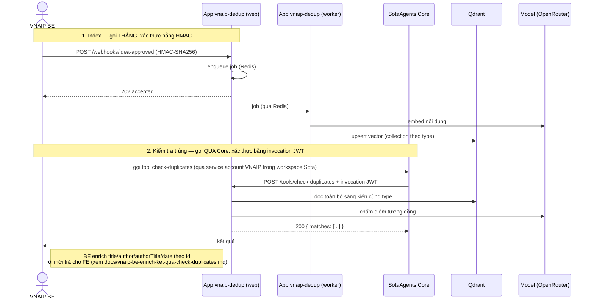

# Final guide cho VNAIP BE: tích hợp app `vnaip-dedup`

App `vnaip-dedup` cung cấp **2 API** cho VNAIP BE:

1. **Webhook index** — VNAIP BE gọi **thẳng** vào app (không qua SotaAgents Core) để
   đẩy nội dung sáng kiến vào kho index, phục vụ kiểm tra trùng lặp sau này.
2. **Tool `check-duplicates`** — gọi **qua SotaAgents Core** (không gọi thẳng vào app),
   dùng để kiểm tra một hồ sơ mới có trùng với sáng kiến đã duyệt không.

Hai API này độc lập và xác thực khác nhau. Mục đích tài liệu này là chốt một chỗ:
gọi API nào, bằng cách nào, và **BE cần tự set/chuẩn bị gì phía hệ thống của mình**.

> Tài liệu chi tiết hơn theo từng API:
> - Webhook: `docs/webhook-vnaip-be.md` (đầy đủ cách ký HMAC, test vector, code mẫu
>   Node/Python/Java, bảng mã lỗi, checklist tự kiểm tra).
> - Enrich kết quả `check-duplicates` ở FE: `docs/vnaip-be-enrich-ket-qua-check-duplicates.md`
>   (field cần tra cứu thêm, ngưỡng badge, quy tắc chọn danh sách hiển thị).
> Tài liệu này không lặp lại toàn bộ hai file trên — chỉ tóm lại phần API + ENV cho
> người triển khai BE đọc một lần là đủ để bắt tay vào việc.

---

## 0. Bức tranh tổng thể



Điểm khác biệt quan trọng nhất giữa hai API:

| | Webhook index | Tool `check-duplicates` |
| --- | --- | --- |
| BE gọi vào đâu | **Thẳng vào app** `vnaip-dedup` | **Qua SotaAgents Core**, không gọi thẳng vào app |
| Xác thực | Chữ ký HMAC-SHA256 do BE tự ký | Invocation JWT do Core ký (app chỉ verify) |
| Ai cấp "quyền gọi" | App cấp secret cho BE | Phía vận hành Sota cấp quyền cho service account của BE trong workspace, và app whitelist claim của service account đó |
| ENV phía hệ thống BE | BE set URL webhook + secret dùng để ký (mục 1) | Không có — BE không gọi thẳng vào app nên không cần ENV nào cho việc này |

---

## 1. API 1 — Webhook index sáng kiến

- **Endpoint:** `POST <base-url-app>/webhooks/idea-approved`
- **Khi nào gọi:** mỗi khi một sáng kiến được duyệt hoặc được cập nhật.
- **Xác thực:** chữ ký HMAC-SHA256 trên raw body, header `X-Webhook-Timestamp` +
  `X-Webhook-Signature`. Không dùng API key.
- **Chi tiết đầy đủ (bắt buộc đọc trước khi code):** `docs/webhook-vnaip-be.md` —
  định dạng body, cách ký, test vector, bảng mã lỗi, ví dụ code 4 ngôn ngữ, checklist.

Tóm tắt nhanh để tra cứu:

```
POST /webhooks/idea-approved
Content-Type: application/json
X-Webhook-Timestamp: <epoch giây>
X-Webhook-Signature: sha256=<hex(HMAC_SHA256(secret, `${timestamp}.${rawBody}`))>

{"id":"GP-1","type":"solutions","title":"...","content":"..."}
```

- `type` phải là `ideas` | `solutions` | `initiatives` (khớp chính xác).
- Body là một object hoặc một mảng object (tối đa 50 phần tử, tối đa 1MB).
- Trả `202 accepted` khi nhận thành công (việc embed + ghi Qdrant chạy nền ở
  worker, không chờ trong response này).
- `id` phải duy nhất trong toàn VNAIP; gửi lại cùng `id` + cùng `type` là update,
  không tạo bản mới.

### ENV liên quan

**Phía hệ thống VNAIP BE** (set trong cấu hình/secret store của BE, tên biến tuỳ BE chọn):

| Biến (gợi ý tên) | Giá trị | Vai trò |
| --- | --- | --- |
| `VNAIP_DEDUP_WEBHOOK_URL` | `<base-url-app>/webhooks/idea-approved` (staging/production khác nhau, xem mục 4) | Nơi BE gửi event khi sáng kiến được duyệt/cập nhật |
| `VNAIP_DEDUP_WEBHOOK_SECRET` | Đúng giá trị secret app gửi (một trong các secret nằm trong `WEBHOOK_HMAC_SECRETS` phía app) | Dùng để **ký** HMAC-SHA256 trên raw body trước khi gửi — không bao giờ gửi secret này qua network |

**BE cần làm:** set 2 biến trên trong hệ thống của mình, ký đúng theo mục 3 của
`docs/webhook-vnaip-be.md`, gửi kèm header timestamp + signature. Không set gì
trong app.

---

## 2. API 2 — Tool `check-duplicates` (`/tools/check-duplicates`)

- **Không gọi thẳng vào app.** Tool này được gọi **qua SotaAgents Core**, bằng
  service account của VNAIP trong workspace Sota (model/agent phía Core thực hiện
  lời gọi, mang invocation JWT do Core ký). App chỉ nhận request từ Core, verify
  JWT, không bao giờ verify request đến thẳng từ BE.
- **Input:** `type` (`ideas`/`solutions`/`initiatives`), `title`, `content`, và tuỳ
  chọn `excludeIds` (loại bớt id khỏi kết quả, ví dụ chính hồ sơ đang sửa),
  `parentSolutionId` (sáng kiến mà hồ sơ kế thừa: không bị báo trùng) và `fileExcerpts`
  (đoạn trích từ file đính kèm).
- **Output:** `{ matches: [{ id, type, score, percent, reason, relation, evidence }, ...] }`, tối đa 30
  mục, đã sort giảm dần theo `percent`, chỉ gồm mục có `percent >= 40` (cấu hình được).
  Xem `docs/vnaip-be-enrich-ket-qua-check-duplicates.md`.
- **Output KHÔNG có** `title`/`author`/`authorTitle`/`date` — BE phải tự tra cứu
  thêm các field này theo `id`, cùng với quyết định badge/ngưỡng hiển thị. Toàn bộ
  phần này đã có spec riêng: **`docs/vnaip-be-enrich-ket-qua-check-duplicates.md`**.

### Endpoint thật qua Core (xác nhận 2026-11-05)

```
POST https://api.v4.sotaagents.ai/api/v3/app-tools/vnaip-dedup/check-duplicates
     ?_sotaEnvironment=stg&_sotaEnvironmentId=<id môi trường app trên Core>
Headers:
  x-org-id: <org id của VNAIP trong Core>
  x-ws-id: <workspace id chứa app vnaip-dedup>
  Authorization: Bearer <token của service account VNAIP, scope tool:check-duplicates>
Body: { "type": "ideas", "title": "...", "content": "...", "excludeIds": [] }
```

Request mẫu (gồm cả case thiếu token → `401`) đã có trong
`postman/vnaip-dedup.postman_collection.json`, dùng environment
`postman/vnaip-dedup-core.postman_environment.json`.

Lưu ý: `x-org-id`/`x-ws-id` là header gửi lên Core để Core biết route đúng
org/workspace; `oid`/`wid` mà app `vnaip-dedup` thực sự kiểm tra lại là **claim
trong invocation JWT** do Core ký sau khi xác thực token — không phải đọc trực
tiếp từ 2 header này. Hai giá trị nên khớp nhau, nhưng app chỉ tin claim trong JWT.

### Việc còn UNRESOLVED (nghiệp vụ chưa xác nhận, phải chốt trước khi lên production)

- Vai trò và tính bắt buộc của `parentSolutionId` trong input schema (hiện được
  nhận nhưng bị bỏ qua, không lọc kết quả).
- Trường hợp `id` trong match không còn tồn tại ở DB VNAIP lúc BE enrich (race
  condition) — bỏ qua match đó hay báo lỗi.

### ENV liên quan

Tool này **không** có ENV nào để BE tự set và gọi trực
tiếp (không có endpoint app lộ ra cho BE gọi thẳng). Thứ BE cần chuẩn bị là **thông
tin** để bên vận hành app điền vào `CHECK_DUPLICATES_ALLOWED_*`, và nơi BE sẽ nhận
kết quả khi Core trả về:

| Thông tin BE cần cung cấp | Trạng thái | Dùng để làm gì |
| --- | --- | --- |
| `sub` của service account BE dùng để gọi tool qua Core | Cần lấy (xem cách bên dưới) | App điền vào `CHECK_DUPLICATES_ALLOWED_SUBS` |
| `oid` của tổ chức VNAIP trong workspace Sota | **Đã có — BE cung cấp** | App điền vào `CHECK_DUPLICATES_ALLOWED_OIDS` |
| `wid` của workspace Sota chứa app này | Cần lấy (xem cách bên dưới) | App điền vào `CHECK_DUPLICATES_ALLOWED_WIDS` |
| Quy mô dữ liệu thật (số sáng kiến mỗi type) | Chưa có | Không còn là ràng buộc cứng (tool chỉ chấm `k` sáng kiến gần nhất, `CHECK_DUPLICATES_TOP_K`, mặc định 20); số liệu dùng để đánh giá `k` đã đủ chưa |

Giá trị `sub`/`oid`/`wid` thật lấy bằng cách: app bật tạm `LOG_VERIFIED_CLAIMS=true`,
cho BE (hoặc agent đại diện BE) gọi tool thử 1 lần qua Core (dùng request Postman ở
trên), rồi đọc log `invocation_accepted` để lấy đúng giá trị.

**BE cần làm:**
1. Cung cấp `sub` và `wid` thật của service account cho team app (`oid` đã có).
2. Tự tra cứu `title`/`author`/`authorTitle`/`date` theo `id` trả về, và áp dụng
   đúng ngưỡng badge + quy tắc chọn danh sách hiển thị theo
   `docs/vnaip-be-enrich-ket-qua-check-duplicates.md`.

---

## 3. Checklist trước khi BE tích hợp thật (production)

- [ ] BE đã nhận secret HMAC từ app qua kênh an toàn.
- [ ] BE đã set `VNAIP_DEDUP_WEBHOOK_URL` và `VNAIP_DEDUP_WEBHOOK_SECRET` (hoặc
      tên tương đương) trong hệ thống của mình, và tự kiểm tra ký HMAC đúng test
      vector trong `docs/webhook-vnaip-be.md`.
- [x] `oid` của VNAIP đã được BE cung cấp.
- [ ] BE đã cung cấp `sub` và `wid` thật của service account cho team app.
- [ ] BE đã test gọi tool qua Core bằng Postman (`vnaip-dedup.postman_collection.json`,
      environment `vnaip-dedup-core.postman_environment.json`) và nhận `200` với
      `matches[]` đúng schema.
- [ ] BE đã implement enrich + ngưỡng badge theo
      `docs/vnaip-be-enrich-ket-qua-check-duplicates.md`.
- [ ] BE đã xác nhận URL webhook đúng cho từng môi trường (staging/production)
      với team app trước khi gọi thật.
